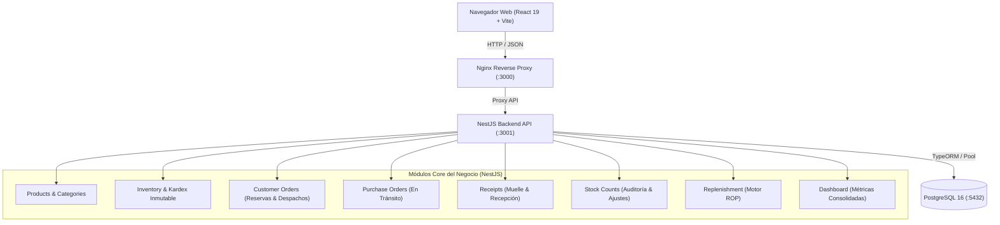
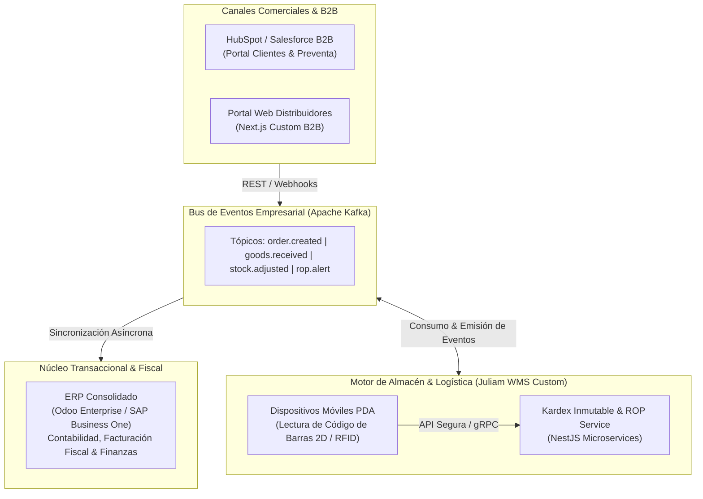

# Juliam Corp LLC — Sistema Centralizado de Inventario & Control Logístico

> **Prueba Técnica:** Resolución de Incidencias e Infraestructura de Inventario  
> **Empresa:** Juliam Corp LLC  
> **Destinatario:** Juliam Aponte  
> **Autor:** Jesús Balza  
> **Fecha de Entrega:** 06 de Noviembre de 2026  
> **Repositorio Oficial:** [GitHub - Carjess/Corp-LLC](https://github.com/Carjess/Corp-LLC.git)

---

## 1. Resumen Ejecutivo y Diagnóstico Inicial

Juliam Corp LLC es una empresa de distribución de suministros para restaurantes y servicios de hostelería (vasos plásticos y térmicos, contenedores de alimentos, cubiertos, servilletas y bolsas kraft). La operación enfrentaba un cuello de botella crítico: el inventario se gestionaba en múltiples archivos de Excel aislados con macros desarrolladas informalmente. Con la incorporación de nuevo personal, la dispersión aumentó, generando desincronización entre las existencias físicas reales y las cifras del sistema, lo que provocó largas filas en despacho, sobreventa y compras a ciegas.

Para resolver la crisis operativa en menos de una semana, la solución se estructuró en tres fases progresivas:
1. **Diagnóstico Inicial:** Análisis de causas raíz, procesos impactados y definición de la estructura de datos mínima de recuperación ([`docs/diagnostico-inicial.md`](docs/diagnostico-inicial.md)).
2. **Fase A (Solución de Contingencia Inmediata / Low-Code):** Plantilla unificada de contingencia protegida en Excel con script automatizado en Python y manual de uso para operadores no técnicos ([`docs/implementacion-fase-a.md`](docs/implementacion-fase-a.md), [`docs/manual-operativo.md`](docs/manual-operativo.md)).
3. **Fase B (MVP Web Centralizado y Dockerizado):** Aplicación web empresarial construida en TypeScript, React, NestJS, TypeORM y PostgreSQL, desplegable en cualquier entorno con Docker Compose.
4. **Propuesta Arquitectónica a Largo Plazo:** Estrategia conceptual de integración empresarial (ERP, CRM, WMS industrial e infraestructura en la nube).

---

## 2. Fase A: Solución Low-Code de Contingencia Inmediata

Diseñada para detener el caos operativo en cuestión de horas sin requerir conocimientos técnicos por parte de los operadores del almacén.

* **Archivo Generado:** [`contingency/Control_Inventario_Juliam.xlsx`](contingency/Control_Inventario_Juliam.xlsx)
* **Script Automatizado:** [`scripts/generar_excel_contingencia.py`](scripts/generar_excel_contingencia.py) (construido con `openpyxl`).
* **Características Principales:**
  - **Catálogo Unificado:** Normalización estricta de códigos SKU, descripciones y unidades de medida (Paquete, Millar, Caja, Fardo).
  - **Kardex Operativo:** Registro de entradas, salidas y ajustes con fórmulas protegidas que calculan el saldo físico en tiempo real.
  - **Separación de Estados:** Control visual de pedidos pendientes y cálculo de stock disponible para despacho inmediato.
  - **Manual Operativo Paso a Paso:** Guía visual detallada para el operador del almacén ([`docs/manual-operativo.md`](docs/manual-operativo.md)).

---

## 3. Fase B: MVP Web Centralizado (Arquitectura del Sistema)

Aplicación web modular basada en una arquitectura en capas (Clean Architecture) orientada a dominio, asegurando alta cohesión, bajo acoplamiento y control estricto de transacciones concurrentes.



### 3.1 Stack Tecnológico Obligatorio
* **Frontend:** React 19, TypeScript, Vite, Lucide Icons, diseño de componentes The Empire en Modo Claro (Verde Menta `#4edea3`, fondos orgánicos `#f3f8f5` y tarjetas con 28px de radio).
* **Tipografías Oficiales:** `Bricolage Grotesque` (Titulares, métricas y display) y `DM Sans` (Cuerpo, tablas y controles de formulario).
* **Backend:** NestJS 11, TypeScript, TypeORM 0.3+, Class-Validator, PostgreSQL driver (`pg`).
* **Base de Datos:** PostgreSQL 16 Alpine con transacciones atómicas (`QueryRunner`).
* **Infraestructura:** Docker & Docker Compose con builds multi-etapa (`node:22-alpine` y `nginx:alpine`).

---

## 4. Reglas de Negocio Fundamentales Implementadas

El sistema resuelve las causas raíz diagnosticadas aplicando rigor matemático y contable:

### 4.1 Separación Estricta de Niveles de Stock
Para erradicar las filas en despacho y las sobreventas, el inventario nunca se escribe a mano; se calcula dinámicamente a partir del historial inmutable:
$$\text{Stock Físico} = \text{Suma de Entradas} - \text{Suma de Salidas} \pm \text{Ajustes Auditados}$$
$$\text{Stock Disponible} = \text{Stock Físico} - \text{Stock Reservado (Pedidos Pendientes)}$$
- **Para despachar:** Se consulta únicamente el Stock Disponible. Un pedido de cliente bloquea y reserva unidades de inmediato; si no hay stock suficiente, el sistema impide la confirmación.
- **Al entregar:** La mercancía sale físicamente del almacén, se descuenta del stock físico y se libera la reserva, generando el movimiento `SALIDA` en el Kardex.

### 4.2 Flujo de Abastecimiento en 3 Pasos
Emitir una orden de compra no incrementa el stock físico. Cada compra sigue el ciclo:
1. **Orden Emitida (`PurchaseOrders`):** Se genera la orden de compra al fabricante (`COM-XXX`) en estado `PENDING`. Sus unidades computan como Mercancía en Tránsito.
2. **Recepción Física en Muelle (`Receipts`):** Al llegar el camión, el operador cuenta y verifica en muelle (`REC-XXX`). Solo las unidades aceptadas generan un movimiento de `ENTRADA` al Kardex e incrementan el Stock Físico.
3. **Cierre de Orden:** Si la recepción cubre el total pedido pasa a `COMPLETED`; si es parcial, pasa a `PARTIAL` y el saldo restante continúa en tránsito.

### 4.3 Conteo Ciego y Conciliación Auditada (`StockCounts`)
- El operador registra el conteo físico ciego observado en estantería sin ver el saldo del sistema.
- El sistema evalúa la desviación: $\Delta = \text{Conteo Observado} - \text{Stock Físico del Sistema}$.
- Si existe discrepancia ($\Delta \ne 0$), el sistema exige obligatoriamente el motivo justificado y el nombre del auditor o aprobador, generando movimientos auditados de `AJUSTE_POSITIVO` o `AJUSTE_NEGATIVO` en el Kardex.

### 4.4 Motor Matemático de Reposición Continua y Punto de Reorden (ROP)
Resuelve la pregunta crítica: *¿Qué pedir para reabastecer el almacén antes de caer en pérdidas?*
$$\text{Punto de Reorden } (ROP) = (d \times L) + SS$$
$$\text{Posición de Inventario } (IP) = \text{Stock Disponible} + \text{Mercancía en Tránsito}$$
$$\text{Condición de Alerta: } IP \le ROP \implies \text{Alerta 'COMPRAR'} \quad | \quad IP > ROP \implies \text{Nivel 'OK'}$$
$$\text{Lote Sugerido de Compra } (Q_{sug}) = \max(0, (ROP + SS) - IP)$$
* **Demanda Diaria ($d$):** Calculada automáticamente a partir del ritmo de salidas reales de Kardex.
* **Lead Time ($L$):** Plazo de entrega garantizado por el proveedor en días hábiles.
* **Stock de Seguridad ($SS$):** Colchón mínimo para absorber variaciones imprevistas de demanda.
* **Criterio Clave:** Si un producto tiene compras en camino que ya cubren el reorden (ej. `VAS-001` con 400 unidades en tránsito), $IP > ROP$ y el sistema no emite falsas alarmas de compra duplicada.

---

## 5. Guía de Despliegue Rápido con Docker

La aplicación está completamente dockerizada para desplegarse con un único comando en cualquier sistema operativo (Windows, Linux, macOS).

### 5.1 Requisitos Previos
* [Docker Desktop](https://www.docker.com/products/docker-desktop/) instalado y en ejecución (con motor WSL2 en Windows o Docker Engine en Linux).
* Git instalado.

### 5.2 Despliegue en 1 Solo Paso
Clona el repositorio y ejecuta:

```bash
# 1. Clonar el repositorio
git clone https://github.com/Carjess/Corp-LLC.git
cd Corp-LLC

# 2. Levantar toda la infraestructura con Docker Compose
docker compose up --build -d
```

### 5.3 Servicios y Puertos Expuestos

| Contenedor | Servicio | Puerto Host | Puerto Contenedor | URL de Acceso |
| :--- | :--- | :---: | :---: | :--- |
| `juliam-frontend` | Interfaz Web React (Nginx) | `3000` | `80` | [http://localhost:3000](http://localhost:3000) |
| `juliam-backend` | API REST NestJS | `3001` | `3001` | [http://localhost:3001/api](http://localhost:3001/api) |
| `juliam-postgres` | Base de Datos PostgreSQL 16 | `5433` | `5432` | `localhost:5433` (db: `juliam_inventory`) |

### 5.4 Semillas de Datos Precargadas Automáticamente
Al iniciar por primera vez, el backend ejecuta automáticamente el servicio de siembra (`SeedService`), precargando:
- **5 Categorías de Retailing:** Vasos, Envases, Cubiertos, Servilletas y Empaques.
- **Catálogo de 7 SKUs Reales:** `VAS-001` (12 oz), `VAS-002` (8 oz), `ENV-001` (Térmico #1), `CUB-001` (3 en 1), `SER-001` (Dispensador 100u), `EMP-001` (Bolsa Kraft #8).
- **Proveedores y Clientes:** Distribuidora Plásticos del Norte, Restaurante El Gran Sabor, Inversiones Burger Grill.
- **Historial Inicial de Kardex:** Movimientos de entrada iniciales verificados.

---

## 6. Catálogo de Endpoints REST de la API

| Módulo | Método | Endpoint | Descripción |
| :--- | :---: | :--- | :--- |
| **Dashboard** | `GET` | `/api/dashboard/stats` | Resumen ejecutivo en tiempo real: KPIs, alertas ROP y últimos movimientos. |
| **Catálogo** | `GET` | `/api/products` | Catálogo de productos con filtros por categoría y búsqueda textual. |
| | `POST` | `/api/products` | Creación de nuevo SKU con umbrales de stock mínimo y de seguridad. |
| **Inventario** | `GET` | `/api/inventory/summary` | Saldos consolidados: físico, reservado, disponible y estado de alerta. |
| | `GET` | `/api/inventory/movements` | Consulta del libro diario inmutable de Kardex con filtros avanzados. |
| | `POST` | `/api/inventory/movements` | Registro atómico de movimientos (`ENTRADA`, `SALIDA`, `AJUSTE`). |
| **Pedidos** | `GET` | `/api/customer-orders` | Listado de pedidos de distribuidores y clientes. |
| | `POST` | `/api/customer-orders` | Registro de pedido con validación y reserva atómica de stock disponible. |
| | `POST` | `/api/customer-orders/:id/dispatch` | Despacho total o parcial: descuento físico y generación de salida en Kardex. |
| **Compras** | `GET` | `/api/purchase-orders` | Listado de compras emitidas y unidades en tránsito por proveedor. |
| | `POST` | `/api/purchase-orders` | Creación de orden de compra en estado `PENDING` (no altera stock físico). |
| **Recepciones** | `GET` | `/api/receipts` | Historial de comprobantes de descarga y verificación en muelle (`REC-XXX`). |
| | `POST` | `/api/receipts` | Recepción física: entrada a Kardex y actualización del saldo de la compra. |
| **Conteos** | `GET` | `/api/stock-counts` | Registro de conciliaciones físicas y variaciones de inventario. |
| | `POST` | `/api/stock-counts` | Registro de conteo con aplicación auditada de ajustes en Kardex. |
| **Reposición** | `GET` | `/api/replenishment` | Matriz ROP completa: demanda ($d$), lead time ($L$), posición ($IP$) y sugerencia ($Q$). |
| | `GET` | `/api/replenishment/alerts` | Consulta directa de artículos con requerimiento urgente de compra ($IP \le ROP$). |

---

## 7. Propuesta Arquitectónica Estratégica a Largo Plazo

> *Cumplimiento del Punto 3 de la Prueba Técnica: Evaluación de integración con soluciones empresariales consolidadas (ERP/CRM/WMS) e infraestructura moderna.*

### 7.1 Diagnóstico de Escala: Cuándo Evolucionar el MVP
El MVP actual resuelve con éxito la contingencia operativa y centraliza los datos. Sin embargo, cuando Juliam Corp LLC supere las 2.000 transacciones diarias, incorpore múltiples almacenes satélite o requiera facturación fiscal automatizada y pasarelas de pago B2B, mantener una arquitectura custom monolítica incrementa el costo de mantenimiento.

### 7.2 Arquitectura Híbrida Empresarial Recomendada

Se propone una Arquitectura Orientada a Eventos (Event-Driven Architecture - EDA) que combine lo mejor del software empresarial consolidado con microservicios especializados:



### 7.3 Componentes de la Solución Definitiva

1. **ERP Centralizado (Odoo Enterprise o SAP Business One):**
   - **Alcance:** Contabilidad legal, cuentas por cobrar y pagar, facturación electrónica fiscal y conciliación bancaria.
   - **Justificación:** Reemplazar el desarrollo a medida de módulos tributarios y contables por una plataforma estándar y madura con soporte normativo continuo.

2. **WMS Especializado a la Medida (Evolución de nuestro MVP en NestJS):**
   - **Alcance:** Control de picking, packing, zonificación por pasillos y tarimas (slotting), conteos cíclicos ciegos con terminales portátiles de radiofrecuencia (pistolas PDA con lectura 2D/QR y RFID) y el motor de cálculo continuo de Punto de Reorden (ROP).
   - **Justificación:** Los ERPs comerciales tradicionales son rígidos en la línea de despacho rápido y conllevan cobro de licencias por cada operario del muelle.

3. **CRM Comercial (HubSpot o Salesforce):**
   - **Alcance:** Gestión de cartera de distribuidores, líneas de crédito, histórico de consumo de restaurantes y cotizaciones automáticas basadas en el stock disponible provisto por el WMS.

4. **Bus de Integración de Eventos (Apache Kafka o RabbitMQ):**
   - **Alcance:** Desacoplamiento total. Si el ERP entra en mantenimiento o corte nocturno, el almacén sigue despachando y recibiendo mercancía sin interrupciones. Cuando el ERP reconecta, procesa los eventos encolados en orden secuencial garantizado.

5. **Infraestructura Cloud de Alta Disponibilidad:**
   - Despliegue en Kubernetes (AWS EKS o Google Cloud GKE) con autoescalado horizontal de pods.
   - Base de datos PostgreSQL Multi-AZ con réplicas de lectura (Read Replicas) para analítica y reportes sin degradar las operaciones transaccionales del muelle.
   - Monitoreo y observabilidad continua con Prometheus, Grafana y OpenTelemetry.

---

## 8. Estructura del Repositorio

```text
Corp-LLC/
├── .env.example                     # Plantilla de variables de entorno seguras
├── .gitignore                       # Filtros de exclusión para Git
├── docker-compose.yml               # Orquestación de contenedores (Frontend, Backend, DB)
├── README.md                        # Documentación técnica maestra y entrega oficial
│
├── backend/                         # Servidor NestJS + TypeScript
│   ├── Dockerfile                   # Build multi-etapa para producción
│   ├── src/
│   │   ├── config/                  # Configuración de base de datos TypeORM
│   │   ├── common/                  # Enums, entidades base e interfaces
│   │   ├── database/seeds/          # Semillas automáticas de inicialización
│   │   └── modules/
│   │       ├── categories/          # Módulo de Categorías de insumos
│   │       ├── products/            # Módulo de Catálogo y umbrales de stock
│   │       ├── inventory/           # Libro diario inmutable de Kardex
│   │       ├── customers/           # Módulo de Clientes y distribuidores
│   │       ├── customer-orders/     # Pedidos con reserva y despacho de stock
│   │       ├── suppliers/           # Módulo de Fabricantes y lead times
│   │       ├── purchase-orders/     # Órdenes de compra y compras en tránsito
│   │       ├── receipts/            # Recepción y descarga física en muelle
│   │       ├── stock-counts/        # Conteo físico ciego y auditoría de ajustes
│   │       ├── replenishment/       # Motor matemático ROP y posición de stock
│   │       └── dashboard/           # Agregación de KPIs ejecutivos en vivo
│
├── frontend/                        # Aplicación SPA React 19 + Vite
│   ├── Dockerfile                   # Build con Node 22 y servidor Nginx Alpine
│   ├── nginx.conf                   # Configuración del servidor Nginx y proxy API
│   ├── index.html                   # HTML con fuentes Bricolage Grotesque y DM Sans
│   └── src/
│       ├── components/              # Vistas operativas y modales balanceados
│       │   ├── dashboard/           # Panel de control ejecutivo y gráficos SVG
│       │   ├── products/            # Vista de catálogo y edición de SKUs
│       │   ├── inventory/           # Visualización de saldos y tabla de Kardex
│       │   ├── customer-orders/     # Gestión de pedidos, reservas y despachos
│       │   ├── purchase-orders/     # Emisión y seguimiento de compras en tránsito
│       │   ├── receipts/            # Muelle de recepción física de mercancía
│       │   ├── replenishment/       # Matriz de punto de reorden y alertas de compra
│       │   ├── stock-counts/        # Conciliación física y auditoría de ajustes
│       │   ├── layout/              # Sidebar con The Empire visual identity
│       │   └── ui/                  # Componentes reutilizables (Pill, Button, Modal)
│       └── services/                # Clientes HTTP por módulo funcional
│
├── contingency/                     # Solución de Contingencia (Fase A)
│   └── Control_Inventario_Juliam.xlsx # Plantilla protegida de uso inmediato
│
├── scripts/                         # Scripts auxiliares y automatización
│   └── generar_excel_contingencia.py# Script generador en Python (openpyxl)
│
└── docs/                            # Documentación analítica y planes maestros
    ├── diagnostico-inicial.md       # Entregable 1 enviado por email a Juliam
    ├── implementacion-fase-a.md     # Documentación técnica de la solución Low-Code
    ├── manual-operativo.md          # Manual paso a paso para el operador del almacén
    ├── plan-fase-b.md               # Plan maestro secuencial de 11 pasos
    └── pruebatecnica.md             # Especificación oficial de la prueba
```

---

## 9. Verificación de Funcionamiento y Pruebas Integrales

Para validar la correcta inicialización y el funcionamiento del flujo de punta a punta:

1. **Reinicio limpio:**
   ```bash
   docker compose down -v
   docker compose up --build -d
   ```
2. **Comprobación de salud de contenedores:**
   ```bash
   docker compose ps
   ```
   Los 3 contenedores (`juliam-postgres`, `juliam-backend`, `juliam-frontend`) deben figurar en estado `Up` / `Healthy`.
3. **Flujo Operativo Integral Comprobado:**
   - **Paso 1:** Al levantar el sistema, el Dashboard muestra 7 SKUs con sus indicadores en verde menta.
   - **Paso 2:** El producto `VAS-001` cuenta con 400 unidades en tránsito de órdenes de compra abiertas (`COM-002`), por lo que su Posición de Inventario ($IP = 1.010$) supera su $ROP$ ($170$), permaneciendo en estado `NIVEL OK` sin disparar falsas compras.
   - **Paso 3:** Se recibe una descarga de 300 unidades en muelle (`REC-002`), lo cual ingresa inmediatamente al Kardex (`ENTRADA`), aumentando el stock físico a 610 y reduciendo el tránsito a 200.
   - **Paso 4:** Se registra un pedido de cliente (`PED-003`) por 100 unidades, reservando automáticamente el stock y garantizando que el stock disponible disminuya a 510 para impedir sobreventas.
   - **Paso 5:** Se realiza el despacho del pedido en almacén, registrando la `SALIDA` en Kardex y liberando la reserva.
   - **Paso 6:** Se realiza un conteo físico ciego en estantería para `ENV-001` arrojando 160 unidades (frente a 150 en sistema). Se justifica el sobrante y se autoriza el ajuste, generando un movimiento inmutable de `AJUSTE_POSITIVO` por +10 unidades.

---
*Juliam Corp LLC &bull; Sistema Centralizado de Inventario &bull; Solución Integral Desarrollada para la Evaluación Técnica 2026.*
